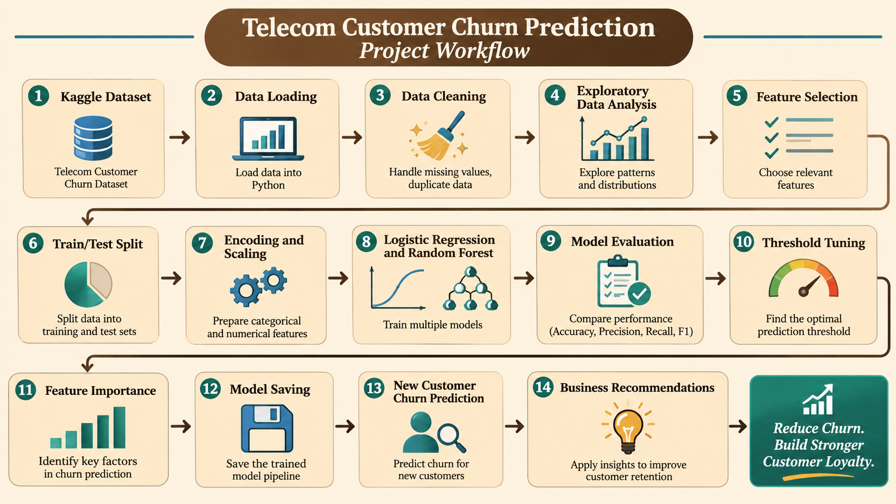

# Telecom Customer Churn Prediction

## Project Overview

This project uses Machine Learning to predict whether a telecom customer is likely to leave the company (churn).

The goal is to identify customers who may churn and help telecom companies improve customer retention.

## Project Workflow

## Machine Learning Algorithms

- Logistic Regression
- Random Forest Classifier

## Technologies Used

- Python
- Pandas
- NumPy
- Scikit-learn
- Matplotlib
- Seaborn
- Jupyter Notebook

## Model Performance

| Model | Accuracy | Precision | Recall | F1 Score |
|---|---:|---:|---:|---:|
| Logistic Regression (0.5) | 80.2% | 66.0% | 52.2% | 58.3% |
| Logistic Regression (0.3) | 76.2% | 53.6% | 74.2% | 62.2% |
| Random Forest (0.5) | 76.2% | 54.5% | 59.7% | 57.0% |

## Key Findings

- TotalCharges, tenure and MonthlyCharges were the three most important features in the Random Forest model.
- Contract type was also an important feature.
- Threshold tuning improved Logistic Regression recall from 52.2% to 74.2%.

## Business Recommendations

- Identify customers who may be at risk of churning.
- Offer suitable plans and contract options.
- Improve customer support and engagement.
- Develop customer retention strategies.

## Project Status

Completed — Model training, evaluation, feature importance and new customer prediction.
